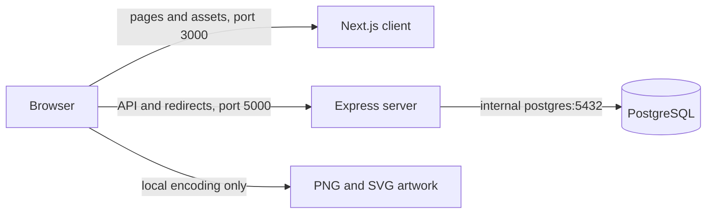

# Workspace and runtime boundaries

The repository is an npm workspace monorepo containing two applications and one
PostgreSQL database. Both applications share the root dependency lock and Node 24
toolchain; they retain separate runtime responsibilities.

| Path | Responsibility |
|---|---|
| `client/` | Next.js pages, short-link and analytics interfaces, browser-local QR generation |
| `server/` | Express HTTP API, redirects, validation, admin-key authorization, Prisma persistence |
| `server/prisma/` | Database schema, versioned migrations and development seed |
| `scripts/` | Root tooling, including a live local-stack smoke check |
| `docs/` | Architecture and engineering contracts |

There is one root `package-lock.json`. Workspaces are private applications named
`@url-shortner/client` and `@url-shortner/server`; dependencies are installed and
coordinated from the root. This avoids independent dependency trees drifting
while preserving the current API and data model. Account ownership, subscriptions
and entitlement enforcement remain later product work.

## Request topology

The browser accesses the public server origin directly. Docker service DNS names
are used between containers, not in browser-facing URLs. The same public API
origin is passed to the client's build and used by the server when returning
short URLs. CORS permits the configured public web origin.

Static QR encoding does not use the API or database. Existing short links and
analytics use the Express routes and per-link admin keys. Moving directories
does not change short codes, endpoint paths or persisted records. The QR-specific
contract is in [qr-generation.md](qr-generation.md).

## Build and container artifacts

The client shares one neutral visual system across link management, analytics
and the QR builder. Inter is bundled locally with its license, preserving the
QR page's lack of third-party requests. Tag colors derive deterministically from
existing tag strings; colors are presentation only and introduce no database or
API fields. Recent links remain browser-local records rather than an account
library. Native dialog behavior manages keyboard focus for link creation.

Docker builds use the repository root as context so both workspaces consume the
same lockfile. The root ignore file excludes local environment files, Git data,
dependency/build caches, local planning and the user's private requirements.

The client builds standalone Next output with the workspace root as its tracing
boundary. Its runtime image contains the traced `client/server.js`, required
modules, static assets and public files. The public API origin is fixed during
the client build; changing only its runtime environment would leave stale browser
configuration.

The server build compiles application and seed code without bundling tests into
the runtime output. Its entrypoint is `dist/src/server.js`. The runtime image
contains production dependencies, the generated Prisma client, the matching
Prisma engine binaries and migrations. Prisma's CLI is a runtime dependency
because the entrypoint deploys migrations before starting HTTP service. App
containers run as the unprivileged Node image user.

## Startup, readiness and persistence

Compose waits for PostgreSQL health before starting the server. The server applies
versioned migrations without resetting data, then replaces the entrypoint shell
with the Node process. Its readiness check performs a database query. The client
starts after server readiness and has a separate QR-page health check.

The existing `postgres-data` volume key is retained. Rebuilding app images or
stopping containers does not erase database contents. Default host bindings are
loopback-only; PostgreSQL's host port is 5433 to avoid the usual local 5432 port.
The sample settings support local testing and are not merchant or paid-launch
configuration.

## Validation boundaries

Workspace unit tests and type checks cover the application modules. Browser
acceptance builds the client and checks actual QR files, desktop/mobile layout,
offline generation and existing navigation. The local stack smoke check uses the
running database/API to exercise readiness, link creation, a temporary redirect,
metadata update, audit and explicit disable; it retains a disabled test record.

Container startup and data persistence require an actual Compose run, not only
configuration validation. Browser emulation and software QR decoding do not
establish physical phone/print acceptance. Local runtime evidence does not prove
hosted availability, account isolation, billing safety or profitability.
